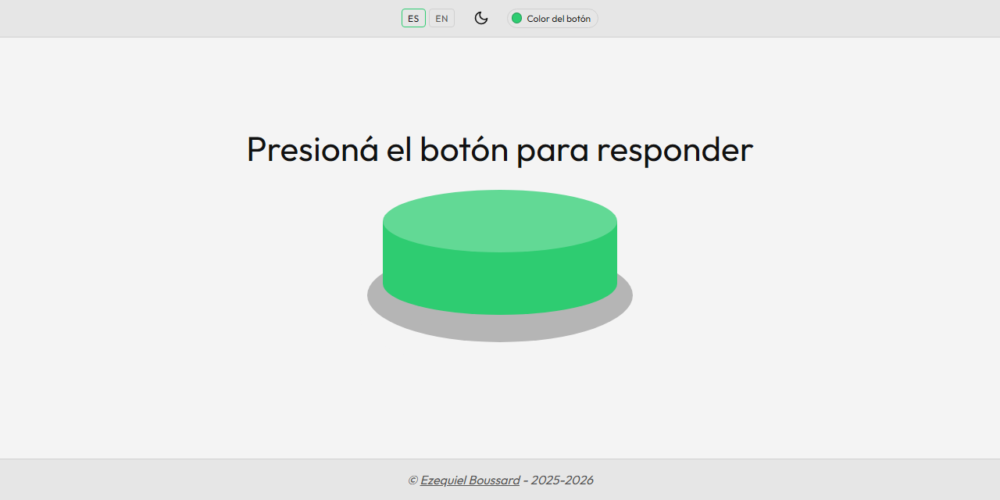

# Buzzify

Pulsador de trivias para el navegador. Mantené presionado el botón y suena el buzzer, de forma continua y sin cortes, hasta que lo soltás.

**[buzzify.pages.dev](https://buzzify.pages.dev/)**

<picture>
  <source media="(prefers-color-scheme: dark)" srcset="assets/screenshots/dark.png">
  
</picture>

Sin dependencias, sin build, sin backend: HTML, CSS y módulos ES nativos. La única tipografía va autoalojada, así que el sitio no pide nada a terceros. El audio tampoco es una grabación: se genera con un modelo físico (ver [El sonido](#el-sonido)).

## Qué hace

- **Sonido continuo mientras se mantiene presionado.** El audio se repite en bucle sin costura audible (ver [El bucle](#el-bucle)).
- **Tema claro y oscuro**, con una transición circular que se expande desde el propio botón de tema.
- **Color del botón configurable**: ocho presets y un selector propio de tono, saturación y luminosidad.
- **Español e inglés.** En la primera visita se elige según `navigator.language`, con inglés como reserva; a partir de ahí manda lo que el visitante haya elegido.
- **Vibración configurable** al pulsar, solo en móviles y tablets: se exige puntero grueso y ausencia de puntero fino, así que un equipo con ratón nunca ve el interruptor. Se puede apagar desde la barra. iOS no implementa la Vibration API, así que ahí el interruptor tampoco aparece.
- **La pantalla no se apaga** mientras la página está a la vista, vía Wake Lock. Un pulsador apoyado en la mesa tiene que seguir encendido cuando llega la pregunta.
- **Funciona con teclado**: `Espacio` o `Enter` mantienen el buzzer sonando mientras la tecla esté pulsada, y los presets de color se recorren con las flechas, con `Inicio` y `Fin` en los extremos.
- **Funciona sin conexión** después de la primera visita, y se puede instalar como aplicación (ver [Sin conexión](#sin-conexión)).
- Las preferencias se guardan en `localStorage` y se aplican antes del primer pintado, sin parpadeo.
- **Capa de entrada** con la marca, el gesto y un conmutador de idioma, que se disipa con el primer toque. Está por las políticas de autoplay, que solo habilitan el audio tras una activación del usuario, y en táctil esa activación llega al cerrarse el gesto, no al apoyar el dedo. Sin ese primer toque en cualquier parte, la primera pulsación sostenida del buzzer se quedaría muda.

Por defecto arranca en tema claro y verde `#2ecc71`.

## Uso local

Los módulos ES y `fetch` necesitan un servidor; abrir el archivo con `file://` no alcanza.

```bash
python -m http.server 8777
```

Después, `http://localhost:8777`.

## Tests

```bash
node --test
```

Necesita Node 22 y nada más.

- [`tests/loop.test.mjs`](tests/loop.test.mjs) arma el mismo zumbido que `tools/buzzer.py`, en JavaScript y a 44,1, 48, 88,2, 96 y 192 kHz, y comprueba lo que describe [El bucle](#el-bucle): los 9 ciclos exactos, que el bucle quede donde el sonido ya se asentó, el empalme del crossfade, el vaivén del grave, que todos los canales se corten en el mismo lugar y que un audio sin tramo útil vuelva sin tocar.
- [`tests/sw.test.mjs`](tests/sw.test.mjs) corre `sw.js` con una red y una caché de mentira: la red primero, la copia sin red o con la red colgada, los links con query, la 404 sin red, las copias de `/index.html` sin la marca de redirección, los pedidos por tramos y la limpieza al activarse.
- [`tests/shell.test.mjs`](tests/shell.test.mjs) cuida que todo `src/` esté en `SHELL` y que el peso del shell escrito en este README, en `sw.js` y en `offline.js` sea el real.

Corren en cada push con GitHub Actions.

## Estructura

```
index.html                 marcado y arranque de preferencias antes del primer pintado
404.html                   página de ruta inexistente, sin scripts, en los dos idiomas a la vez
sw.js                      service worker: guarda el sitio y lo sirve sin red
site.webmanifest           metadatos de PWA
_headers                   cabeceras de caché y seguridad para Cloudflare Pages
assets/audio/              audio.m4a y audio.ogg (respaldo donde no hay AAC)
assets/fonts/              Outfit variable, subconjunto latino, autoalojada, con su OFL
assets/og-card.jpg         tarjeta para redes, 1200x630
assets/screenshots/        capturas para este README, no las pide el sitio
assets/icons/              favicons, apple-touch-icon e iconos del manifest
src/css/style.css
src/js/main.js             cablea los módulos con el DOM
src/js/buzzer.js           puntero y teclado sobre el botón
src/js/audio.js            reproducción con Web Audio
src/js/loop.js             construye el bucle sin costura
src/js/intro.js            capa de entrada que habilita el audio
src/js/haptics.js          vibración al pulsar y su interruptor
src/js/wakelock.js         mantiene la pantalla encendida
src/js/offline.js          registra el service worker
src/js/storage.js          lee y escribe preferencias sin romperse en modo privado
src/js/platform.js         detección de iOS, compartida por audio e intro
src/js/theme.js            claro/oscuro y la transición circular
src/js/color.js            presets y selector HSL
src/js/i18n.js             textos de accesibilidad y cambio de idioma
tools/buzzer.py            genera el audio; no interviene en el sitio
tests/                     tests del bucle, del service worker y del shell
.github/workflows/         corre los tests en cada push
```

El texto visible está duplicado en el HTML con atributos `data-t` y se conmuta por CSS según `html[lang]`. JavaScript solo se ocupa de los `aria-label`, que no se pueden expresar en el marcado por duplicado.

## El sonido

Lo genera [`tools/buzzer.py`](tools/buzzer.py) a partir de un modelo de zumbador electromagnético. Una lengüeta metálica es atraída por una bobina dos veces por ciclo de red; cada tirón es un golpe, con un click de contacto y un puñado de modos mecánicos que resuenan. Los dos golpes de cada ciclo no son idénticos, y esa asimetría es la que hace que un zumbador suene a zumbador y no a tono: pone bandas laterales a 60 Hz alrededor del contenido brillante mientras los modos graves repiten a 120 Hz.

Un período se construye plegando la cola de cada modo sobre sí misma, así que el tramo sostenido es exactamente periódico en 735 muestras a 44,1 kHz. La lengüeta igual arranca desde el reposo: los modos pesados tardan más en llegar a su excursión completa que los livianos, y por eso los primeros 300 ms no son loopeables.

El nivel se fija con ponderación A y no con RMS crudo. El oído es mucho más sensible cerca de los 3 kHz que en los 120 Hz del zumbador, así que dos versiones al mismo RMS pueden quedar muy distintas de volumen; ponderar primero deja el nivel percibido quieto mientras se retocan los modos. Los dos formatos salen del mismo archivo, así que tampoco cambia según el navegador.

Regenerar ambos, con ffmpeg en el PATH:

```bash
uv run --with numpy python tools/buzzer.py
```

## El bucle

Reproducir el archivo con `loop = true` produce un golpe audible en cada vuelta, por dos motivos que se resuelven por separado.

El primero es que el archivo es un disparo único: abre y cierra con una rampa. Repetirla reproduce ese hueco una y otra vez.

El segundo es que **no es un tono estacionario**: su banda grave crece alrededor de un 25 % en el arranque, la mitad en los primeros 50 ms, mientras la banda aguda ya está entera desde el primer golpe. Cualquier bucle que incluya ese tramo reinicia el bajo más abajo de donde terminó, y eso se escucha como un bombo periódico.

`loop.js` busca el tramo donde la banda grave ya se acercó a su nivel final, elige el largo que mejor correlaciona con el arranque -sin asumir periodicidad-, pone el bucle al final de ese tramo y funde la cola sobre la cabeza con un crossfade lineal de 20 ms. El buffer queda en 150 ms y el análisis tarda entre 4 y 14 ms en el hilo principal, así que corre en la primera pulsación sin bloquear nada.

El tramo se detecta con tolerancia y, con este audio, arranca a los 30 ms. El nivel del grave medido en bloques de 10 ms llega a apartarse un 19 % de su valor típico con el propio zumbido, porque cada bloque agarra una fracción distinta del ciclo de red, y con esa oscilación la tolerancia de 12 % no encuentra un tramo largo y entra la de 20 %. Ahí el grave todavía sube: un bucle puesto al principio del tramo iba del 90 al 96 % y repetía esa subida en cada vuelta, un vaivén de 5 a 6 %. Como el largo sirve en cualquier lugar del tramo, el bucle va al final, a los 461 ms en ogg y a los 471 en aac, donde el sonido ya se asentó: el vaivén queda en 0,3 % con aac y en 1,5 % con ogg.

El algoritmo no sabe nada del modelo que generó el sonido y aun así el largo que elige cae siempre en 9 ciclos de red exactos, en ogg y en aac, a 44,1, 48, 88,2, 96 y 192 kHz. Ayuda que el piso de 150 ms sean justo 9 ciclos a 60 Hz: con un zumbido de 50 Hz, a 44,1 y 88,2 kHz se queda en 7,5 ciclos, porque los dos golpes de cada ciclo se parecen demasiado para que la correlación distinga el ciclo entero del medio.

En la unión no hay salto: el crossfade arranca justo en la muestra que seguía al final del bucle. Lo que mide el empalme es cuánto difiere lo que se repite de lo que hubiera seguido. Con aac son -41 dB. Con ogg son -23, y no es el bucle: Vorbis le agrega ese ruido al sonido entero, que en el original repite idéntico ciclo a ciclo. Por eso se sirve aac primero (ver [Compatibilidad](#compatibilidad)). Las cifras salen de decodificar el audio en Chrome a cada sample rate.

Los umbrales están en milisegundos y no en muestras, para que el resultado no dependa del sample rate al que el navegador abra el `AudioContext`.

Se reproduce con `AudioBufferSourceNode` y `loop = true`, que repite el buffer con exactitud de muestra.

## Sin conexión

El sitio entero pesa 117 KB, así que [`sw.js`](sw.js) lo guarda completo en la primera visita y después funciona sin red: marcado, estilos, los trece módulos, la tipografía y los dos formatos de audio. No entra el resto de los iconos ni la imagen para redes: el favicon SVG alcanza, y lo demás lo pide el sistema al instalar o al compartir, siempre estando en línea. Un pulsador que deja de andar porque se cayó el wifi del salón no sirve de nada.

Con red, cada pedido va primero a la red y la copia guardada se pone al día de fondo; la copia sale sin red, o si la red no contesta en 3 segundos. Al principio era al revés, la copia primero y la red de fondo: abría al instante, pero después de cada despliegue la primera visita mostraba la versión anterior. El worker nuevo toma el control apenas se instala, sin esperar a que se cierren las pestañas.

Como hay manifest y service worker con manejador de `fetch`, la página se puede instalar: en Android y escritorio el navegador ofrece hacerlo, y en iOS se agrega desde Compartir. Instalada abre sin barra de direcciones y sin conexión.

Cuatro casos que el service worker atiende aparte:

- Un enlace compartido llega con `?utm_source` y demás. En una navegación la query no cuenta para buscar en caché, y las respuestas con query no se guardan: si no, cada variante dejaría su propia copia de la portada.
- Una ruta inexistente sin red devuelve la 404 guardada, pero reetiquetada como 404. La copia en caché es un 200 y servirla tal cual diría que la ruta existe.
- Cloudflare Pages responde `/index.html` y `/404.html` con un 308 hacia `/` y `/404`. Una respuesta que llegó siguiendo una redirección no se puede devolver a una navegación, así que se guarda una copia sin esa marca. Sin eso, entrar por `/index.html` con el worker instalado daba error de red.
- Safari pide medios por tramos. Una respuesta guardada es entera, y contestar 200 a un `Range` rompe la reproducción, así que esas peticiones van directo a la red.

## Compatibilidad

El audio se sirve en AAC, con una copia en Ogg Vorbis para los navegadores que no tienen AAC, como Chromium o Firefox en algunos Linux. Con este sonido AAC mete unos 20 dB menos de ruido y pesa 11 KB contra 14. Si la decodificación del formato elegido falla de todas formas, se reintenta con el otro.

La transición de tema usa la View Transitions API y se degrada a un fundido CSS donde no está disponible. `color-mix()` tiene un color de reserva declarado antes.

En iOS hay dos obstáculos distintos. El primero es la política de autoplay: el contexto de audio se desbloquea reproduciendo un buffer silencioso dentro del primer gesto del usuario. El segundo es el interruptor lateral de silencio, que silencia Web Audio porque WebKit lo enruta por la categoría `ambient` del sistema; subir el volumen no cambia nada. Desde iOS 16.4 se corrige declarando `navigator.audioSession.type = 'playback'`, y en versiones anteriores se consigue el mismo cambio de categoría reproduciendo una pista WAV silenciosa en bucle, generada en memoria, dentro de ese mismo primer gesto. La contrapartida es que esa categoría no mezcla: al entrar, pausa el audio que el visitante tuviera sonando.

## Despliegue

Sin paso de compilación. En Cloudflare Pages: preset de framework **None**, comando de build vacío, directorio de salida la raíz del repositorio.

Sin un `404.html` en la raíz, Cloudflare Pages responde cualquier ruta inexistente con un 200 y la portada. Esa página existe para que devuelva un 404 de verdad; no lleva scripts, así que no suma hashes a la CSP.

`_headers` fija revalidación en el HTML, en `src/`, en `sw.js` y en el audio, y una semana en fuentes, iconos e imágenes. Ningún archivo lleva hash en el nombre, así que ninguno puede marcarse `immutable`: el audio se regeneró dos veces y quien ya hubiera entrado se habría quedado con la primera copia. Fuentes, iconos e imágenes aguantan una semana porque cambiarlos implica cambiar también el nombre.

Al agregar o renombrar un archivo hay que ponerlo en la lista `SHELL` de [`sw.js`](sw.js), o no se guarda y la página queda rota sin conexión. Es el único paso manual, y si falta un archivo de `src/` los tests avisan. Cambiarle el contenido a uno que ya está en la lista no pide nada, y sacarlo de la lista tampoco: al activarse, el worker borra de la caché todo lo que ya no figura en `SHELL`. `VERSION` queda para tirar la caché entera de una.

El mismo archivo declara una CSP con `default-src 'none'` y permisos explícitos por tipo de recurso. El service worker necesita `worker-src 'self'`; sin declararlo heredaría de `script-src`, pero conviene que esté dicho. El script de arranque y el `<style>` del `<noscript>` van inline, así que se autorizan por hash. Si se edita cualquiera de los dos hay que recalcular el suyo; el parser normaliza CRLF a LF antes de hashear, de ahí el reemplazo:

```bash
python - <<'PY'
import base64, hashlib, io, re
html = io.open('index.html', encoding='utf-8', newline='').read().replace('\r\n', '\n')
for tag in ('script', 'style'):
    for body in re.findall(f'<{tag}>(.*?)</{tag}>', html, re.S):
        print(tag, 'sha256-' + base64.b64encode(hashlib.sha256(body.encode()).digest()).decode())
PY
```

## Licencia

Copyright (c) 2025-2026 Ezequiel Boussard.

Código y audio bajo licencia MIT. Ver [LICENSE](LICENSE).

La tipografía Outfit es de The Outfit Project Authors y se distribuye bajo SIL Open Font License 1.1, con su texto en [assets/fonts/OFL.txt](assets/fonts/OFL.txt). Esa licencia es independiente de la del resto del proyecto y solo alcanza al archivo de fuente.

Hecho por [Ezequiel Boussard](https://ezequiel.is-a.dev).
